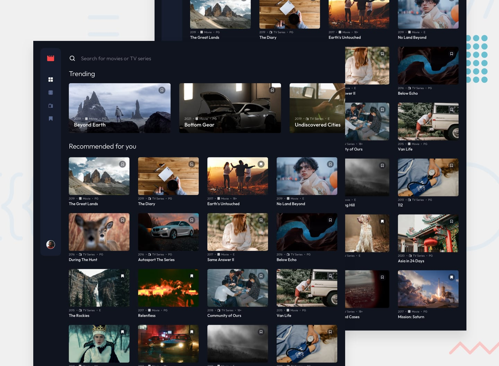

# Frontend Mentor - Entertainment web app



## Table of contents

- [Overview](#overview)
  - [The challenge](#the-challenge)
  - [Links](#links)
- [My process](#my-process)
  - [Built with](#built-with)
  - [What I learned](#what-i-learned)
- [Author](#author)
- [Building your project](#building-your-project)
- [Deploying your project](#deploying-your-project)
- [Create a custom `README.md`](#create-a-custom-readmemd)
- [Submitting your solution](#submitting-your-solution)
- [Sharing your solution](#sharing-your-solution)
- [Got feedback for us?](#got-feedback-for-us)

## Overview

### The challenge

Your challenge is to build out this entertainment web app and get it looking as close to the design as possible. It is a multi-page React and TypeScript site with sign-up, login, a movies catalogue, TV series and bookmarked favourites. Every catalogue page can be searched, and the shows are read from `data.json` through JSON-Server.

You can use any tools you like to help you complete the challenge. So if you've got something you'd like to practice, feel free to give it a go.

Your users should be able to:

- View the optimal layout for the app depending on their device's screen size
- See hover states for all interactive elements on the page
- Navigate between Home, Movies, TV Series, and Bookmarked Shows pages
- Add/Remove bookmarks from all movies and TV series
- Search for relevant shows on all pages
- Create an account and log in, with every field required and validated before the form is sent
- **Bonus**: Build this project as a full-stack application (JSON-Server serves the catalogue, saves bookmarks and stores new members in `data.json`)

#### Expected Behaviour

- General
  - The navigation menu should be fixed to the left for larger screens. Use the "Desktop - Home" page in the design as a visual reference.
- Home
  - The trending section should scroll sideways to reveal other trending shows
  - Any search input should search through all shows (i.e. all movies and TV series)
- Movies
  - This page should only display shows with the "Movie" category
  - Any search input should search through all movies
- TV Series
  - This page should only display shows with the "TV Series" category
  - Any search input should search through all TV series
- Bookmarked Shows
  - This page should display all bookmarked shows from both categories
  - Any search input should search through all bookmarked shows
- Sign up and login
  - Submitting with an empty email or password shows a red bottom border and a "Can’t be empty" warning on that field
  - The email must look like `name@domain.suffix` (for example `.it`, `.ca` or `.com`)
  - The password needs at least 8 characters, including one capital letter, one number and one special character
  - New members are posted with `fetch` to JSON-Server, which writes them into `data.json`

### Links

- Live Site URL: [github pages](https://gerardocianciulli.github.io/Entertainment-web-app/)

## My process

### Built with

- Semantic HTML5 markup
- CSS custom properties
- Flexbox
- CSS Grid
- Desktop-first workflow with media queries (all units in `rem`)
- React
- Typescript
- Vite (multi-page build) with vite-plugin-svgr
- Fetch API
- JSON-Server
- Formik
- Yup
- jQuery
- gh-pages

### What I learned

**SVG icons as React components with vite-plugin-svgr.** The icons in `/assets` have hard-coded fills. With `replaceAttrValues` the plugin swaps those colours for `currentColor`, so CSS alone controls the idle, hover and active colours of the navigation and bookmark icons.

```ts
// vite.config.ts
svgr({
  svgrOptions: { replaceAttrValues: { '#5A698F': 'currentColor', '#FFF': 'currentColor' } },
});
```

```tsx
import HomeIcon from '/assets/icon-nav-home.svg?react';

<a className="nav__link" href={pageUrl.home} aria-current="page">
  <HomeIcon aria-hidden="true" />
</a>;
```

```css
.nav__link { color: var(--color-greyish-blue); }
.nav__link:hover { color: var(--color-red); }
.nav__link[aria-current='page'] { color: var(--color-white); }
```

**Validating forms with Formik and Yup.** One Yup schema describes every rule, and Formik only shows an error once a field has been touched or the form has been submitted. This produces the "Can’t be empty" state from the design.

```ts
const password = Yup.string()
  .required('Can’t be empty')
  .min(8, 'At least 8 characters')
  .matches(/[A-Z]/, 'Needs a capital letter')
  .matches(/\d/, 'Needs a number')
  .matches(/[^A-Za-z0-9\s]/, 'Needs a special character');

export const signUpSchema = Yup.object({
  email: Yup.string().trim().required('Can’t be empty').matches(EMAIL_PATTERN, 'Invalid email'),
  password,
  repeatPassword: Yup.string().required('Can’t be empty').oneOf([Yup.ref('password')], 'Passwords don’t match'),
});
```

**Fetch with JSON-Server, plus a static fallback.** Locally, `npm start` runs JSON-Server next to Vite, so bookmarks are saved with `PATCH /videos/:id` and new members with `POST /users`. GitHub Pages can't run a server, so the build includes a read-only copy of the catalogue, and bookmarks fall back to `localStorage`.

```ts
export async function saveBookmark(id: number, isBookmarked: boolean) {
  if (await isApiAvailable()) {
    await request(`/videos/${id}`, { method: 'PATCH', body: JSON.stringify({ isBookmarked }) });
    return;
  }
  writeLocal(BOOKMARKS_KEY, { ...readLocal(BOOKMARKS_KEY, {}), [id]: isBookmarked });
}
```

**Using jQuery inside React without fighting it.** React owns the DOM, so jQuery only adds behaviour. The handlers are attached in `useEffect` under an event namespace, and the cleanup function removes them. jQuery drives the drag-to-scroll trending carousel, the `/` and `Escape` search shortcuts, and moving focus to the first invalid field after a failed submit.

```ts
useEffect(() => {
  const $element = $(ref.current!);
  $element.on('mousedown.dragscroll', (event) => { /* remember start position */ });
  $(window).on('mousemove.dragscroll', (event) => { /* update scrollLeft */ });
  return () => {
    $element.off('.dragscroll');
    $(window).off('.dragscroll');
  };
}, [ref]);
```

## Author

- Portfolio - [Gerardo Cianciulli](https://www.behance.net/gerardo-cianciulli)
- Frontend Mentor - [Gerardo Cianciulli](https://www.frontendmentor.io/profile/GerardoCianciulli)
- Linkedin - [Gerardo Cianciulli](https://www.linkedin.com/in/gerardo-cianciulli/)

## Building your project

Feel free to use any workflow that you feel comfortable with. Below is a suggested process, but do not feel like you need to follow these steps:

1. Separate the `starter-code` from the rest of this project and rename it to something meaningful for you. Initialize the codebase as a public repository on [GitHub](https://github.com/). Creating a repo will make it easier to share your code with the community if you need help. If you're not sure how to do this, [have a read-through of this Try Git resource](https://try.github.io/). **⚠️ IMPORTANT ⚠️: There are already a couple of `.gitignore` files in this project. Please do not remove them or change the content of the files. If you create a brand new project, please use the `.gitignore` files provided in your new codebase. This is to avoid the accidental upload of the design files to GitHub. With these premium challenges, please be sure not to share the design files in your GitHub repo. Thanks!**
2. Configure your repository to publish your code to a web address. This will also be useful if you need some help during a challenge as you can share the URL for your project with your repo URL. There are a number of ways to do this, and we provide some recommendations below.
3. Look through the designs to start planning out how you'll tackle the project. This step is crucial to help you think ahead for CSS classes to create reusable styles.
4. Before adding any styles, structure your content with HTML. Writing your HTML first can help focus your attention on creating well-structured content.
5. Write out the base styles for your project, including general content styles, such as `font-family` and `font-size`.
6. Start adding styles to the top of the page and work down. Only move on to the next section once you're happy you've completed the area you're working on.

## Deploying your project

As mentioned above, there are many ways to host your project for free. Our recommended hosts are:

- [GitHub Pages](https://pages.github.com/)
- [Vercel](https://vercel.com/)
- [Netlify](https://www.netlify.com/)

You can host your site using one of these solutions or any of our other trusted providers. [Read more about our recommended and trusted hosts](https://medium.com/frontend-mentor/frontend-mentor-trusted-hosting-providers-bf000dfebe).

## Create a custom `README.md`

We strongly recommend overwriting this `README.md` with a custom one. We've provided a template inside the [`README-template.md`](./README-template.md) file in this starter code.

The template provides a guide for what to add. A custom `README` will help you explain your project and reflect on your learnings. Please feel free to edit our template as much as you like.

Once you've added your information to the template, delete this file and rename the `README-template.md` file to `README.md`. That will make it show up as your repository's README file.

## Submitting your solution

Submit your solution on the platform for the rest of the community to see. Follow our ["Complete guide to submitting solutions"](https://medium.com/frontend-mentor/a-complete-guide-to-submitting-solutions-on-frontend-mentor-ac6384162248) for tips on how to do this.

Remember, if you're looking for feedback on your solution, be sure to ask questions when submitting it. The more specific and detailed you are with your questions, the higher the chance you'll get valuable feedback from the community.

**⚠️ IMPORTANT ⚠️: With these premium challenges, please be sure not to upload the design files to GitHub when you're submitting to the platform and sharing it around. If you've created a brand new project, the easiest way to do that is to copy across the `.gitignore` provided in this starter project.**

## Sharing your solution

There are multiple places you can share your solution:

1. Share your solution page in the **#finished-projects** channel of the [community](https://www.frontendmentor.io/community). 
2. Tweet [@frontendmentor](https://twitter.com/frontendmentor) and mention **@frontendmentor**, including the repo and live URLs in the tweet. We'd love to take a look at what you've built and help share it around.
3. Share your solution on other social channels like LinkedIn.
4. Blog about your experience building your project. Writing about your workflow, technical choices, and talking through your code is a brilliant way to reinforce what you've learned. Great platforms to write on are [dev.to](https://dev.to/), [Hashnode](https://hashnode.com/), and [CodeNewbie](https://community.codenewbie.org/).

We provide templates to help you share your solution once you've submitted it on the platform. Please do edit them and include specific questions when you're looking for feedback. 

The more specific you are with your questions the more likely it is that another member of the community will give you feedback.

## Got feedback for us?

We love receiving feedback! We're always looking to improve our challenges and our platform. So if you have anything you'd like to mention, please email hi[at]frontendmentor[dot]io.

**Have fun building!** 🚀
